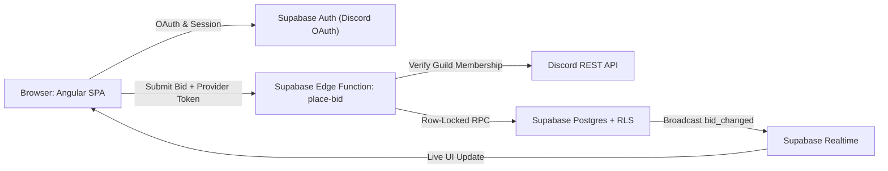

If you have ever played on a heavily modded or active *Conan Exiles* server, you know how messy player-to-player trading gets. Without a standardized fiat currency, server economies run on barter and high-value commodities: Blood Crystals, Fragments of Power, Gold Bars, or Eldarium. 

Trying to run an auction in a Discord text channel quickly turns into a wall of noise: players arguing over exchange rates ("Is 500 Blood Crystals worth more than 20 Fragments of Power?"), sniping bids at the last second, and flooding trade channels with endless chatter.

To fix this, I built **[Conan Exiles Auction](https://auction.aymkh.tn)**: a lightweight, real-time web application designed for gaming communities to run structured, multi-currency auctions without a Discord bot or channel bloat.

## The Core Problem: Multi-Currency Valuation

In standard auction systems, every bid is a single scalar number. In *Conan Exiles*, a seller might accept three different resources for a rare thrall or legendary weapon, each valued differently depending on the server's current meta.

Instead of forcing players to convert everything manually, the platform lets auction creators define **custom currency weights** per listing:

* **Fragments of Power:** Weight `50`
* **Gold Bars:** Weight `10`
* **Blood Crystals:** Weight `1`

When a bidder submits an offer, say, `15 Gold Bars` (weighted value: `150`), the system validates it against the current highest weighted bid (`100 Blood Crystals` = `100`). Both open and blind auction formats are supported, keeping trade channels clean while giving players a dedicated, live interface to track active listings on their server.

## Architecture & Tech Stack

I wanted zero-maintenance infrastructure with strict server-side security, avoiding the overhead of hosting and managing a persistent Discord bot.

* **Frontend:** Angular 22+ (Standalone components, Signals for local reactive state, Tailwind CSS) hosted on Netlify.
* **Backend & Auth:** Supabase (PostgreSQL, Row-Level Security, Realtime, and Deno Edge Functions).
* **Identity & Guild Verification:** Discord OAuth (`identify` and `guilds` scopes).
* **CI/CD:** GitHub Actions automating database migrations, Edge Function deployments, and tagged releases.

## Key Engineering Decisions

### 1. Bot-Free Discord Server Verification

Most Discord-integrated web apps require inviting a bot to your server just to check if a user belongs to that guild. Instead, I leveraged Supabase's Discord OAuth provider with the `guilds` scope.

When a user signs in, the client receives a Discord provider token and queries Discord's `/users/@me/guilds` endpoint to render their servers. When placing a bid, the browser passes that provider token to a Supabase Edge Function (`place-bid`), which independently verifies the user's identity and confirms active membership in the auction's Discord server before allowing the bid through.

### 2. Bulletproof Bidding with Postgres Row Locking

Client-side validation is great for UX, but in a live auction where two players might bid within milliseconds of each other, race conditions can corrupt bid history.

Direct `INSERT` and `SELECT` access on the `bids` table is completely revoked from the public client. Instead, all bids funnel through the `place-bid` Edge Function into a privileged `place_auction_bid` PostgreSQL function:

1. **Row-Level Lock:** Postgres locks the target `auctions` row for the duration of the transaction, serializing concurrent bids.
2. **Server-Side Revalidation:** The database verifies that the auction is `ACTIVE`, hasn't passed its `end_time`, the bidder isn't the seller, and the chosen currency has a positive integer weight.
3. **Weighted Comparison:** It computes `amount * weight` and ensures the new bid strictly exceeds the current highest weighted bid before inserting.

### 3. Live Updates via Private Realtime Topics

Once a bid commits in Postgres, a database trigger broadcasts a `bid_changed` event over a private Supabase Realtime channel scoped to that specific auction. Connected Angular clients listening to the channel automatically refresh the bid history via a secure `get_auction_bids` RPC function—keeping blind auctions genuinely blind until the seller ends them.

## Automated Releases & Self-Hosting

The entire project is structured to be fork-friendly for server admins who want to run their own isolated instancegg.

* **Database & Edge Functions:** Pushing changes to `supabase/migrations/` or `supabase/functions/` triggers a GitHub Actions workflow that links the Supabase project, applies ordered SQL migrations, and deploys the Deno Edge Function.
* **Frontend Releases:** A local release script (`npm run release -- patch|minor|major`) runs the test suite, bumps `package.json`, rolls `[Unreleased]` changelog entries into a dated release, and pushes a `v*` Git tag. GitHub Actions catches the tag, creates a GitHub Release, builds the Angular production bundle, and deploys it to Netlify.

## Wrapping Up

Building **Conan Exiles Auction** was a great exercise in treating the browser strictly as an untrusted presentation layer while pushing concurrency control, authorization, and realtime state distribution down into PostgreSQL and Edge Functions.

If you run a *Conan Exiles* server, or any community with a custom barter economy, feel free to check out the live app or fork the repository to host your own instance.