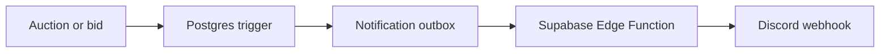

The auction platform already has live bids, sealed offers, custom currencies, and private realtime updates. The missing piece was a simple one: letting server members know that a new auction had opened, that someone had bid, or that an auction was about to end.

I wanted those notifications to improve the community experience without adding the usual Discord bot, infrastructure, and moderation permissions. Discord webhooks were the right fit, with a little PostgreSQL and Supabase machinery behind them.

## Keeping It Bot-Free

A server owner can paste a Discord webhook URL into the guild dashboard. The web application verifies that the signed-in Discord account actually owns that guild and that the webhook belongs to the same server.

It then sends a test embed and stores the configuration.

This matters because the application does not need to join every server as a bot or read channel history. Discord only receives a small, explicit POST containing an embed.

Webhook URLs are protected server-side. Normal users cannot read or edit them directly, and anonymous or sealed auction information is never included in the notification payload.

## Turning Auction Events Into Outbox Rows

The first implementation question was where notification delivery should live.

Calling Discord directly from the Angular client was tempting, but it would make delivery dependent on someone keeping the page open. It would also put webhook and Discord identity logic in an untrusted browser.

Instead, PostgreSQL database triggers turn important events into durable work:

- a new active auction creates an `auction_created` notification
- an open or anonymous bid creates a `bid_placed` notification
- a nearing-end auction creates an `auction_reminder` notification

These rows live in a `discord_notification_outbox` table. The table tracks delivery status, retry time, attempt count, and the last error.



The browser creates an auction or bid normally. A trigger records the notification, and a Supabase Edge Function handles the external HTTP call.

Sealed bids never enter this live notification flow.

## A Reliable Dispatch Layer

The Edge Function has a few jobs:

1. Verify the auction or bid still exists and is eligible.
2. Look up the guild's webhook.
3. Build a Discord embed.
4. POST the embed to Discord.
5. Mark the outbox row as sent, skipped, or pending retry.

There are two dispatch entry points.

The user-dispatched function runs after an auction is created, after an open or anonymous bid is placed, or when a user opens a guild dashboard. It verifies the Supabase and Discord identities and also limits bid notifications to the seller or bid author.

The scheduled function runs independently for ending-soon reminders.

## Retrying Without Duplicates

Webhook delivery can fail because Discord is temporarily unavailable, rate limits the request, or rejects an invalid webhook.

Rather than retrying blindly, the system claims a row with a Postgres lock and updates its status and attempt count. Pending rows receive an exponential retry delay:

```text
60, 120, 240, 480, ... seconds
```

The delay is capped at six hours. HTTP 429 responses wait at least sixty seconds.

Partial unique indexes prevent duplicate creation, bid, or reminder rows. `FOR UPDATE SKIP LOCKED` allows multiple workers to claim different notifications instead of blocking on the same row.

If a worker crashes after claiming a notification, a five-minute claim timeout makes the row eligible for recovery.

## Auction and Bid Embeds

An auction-created embed includes:

- title and description
- bidding format
- end time
- accepted currencies
- auction items
- the first auction image

A bid embed includes the bid amount and weighted value, bidding format, item, end time, and auction image. Open bids can show the bidder name and avatar. Anonymous bids use a neutral "Anonymous bidder" label.

All notification messages disable mention parsing, so auction text cannot tag Discord users or roles.

## The Ending-Soon Reminder

The final piece is a reminder cron job.

`pg_cron` invokes the scheduled Edge Function every minute. The function:

1. Finds active auctions ending within one hour.
2. Confirms they already have a successfully sent creation notification.
3. Adds a reminder row to the outbox.
4. Claims and dispatches due reminders.

The cron SQL reads the project URL and service-role key from Supabase Vault instead of storing those values in migration files.

## Why This Fits the Project

This feature follows the same philosophy as the rest of Conan Exiles Auction:

- keep Discord as an integration point, not the application database
- verify authorization on the server
- let PostgreSQL coordinate state
- use short-lived Edge Functions for external HTTP
- preserve durable work even if the browser closes

The result is a notification system with no persistent bot process and no polling from the Angular application. Database changes create notification work, the outbox provides retries, and Discord receives only the approved, formatted update.

Most importantly, the notification feature is an extension of the auction system rather than a separate integration. Triggers, Edge Functions, realtime bidding, and the same access rules all work from the same Postgres state.
